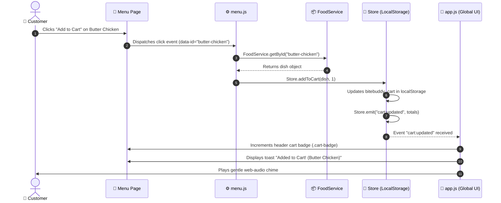

# 🏛️ BiteBuddy System Architecture & Runtime Data Flow

**Project:** BiteBuddy (Food Delivery & Restaurant Management System)  
**Document Version:** 1.0.0  
**Updated:** October 29, 2026  

---

## 1. High-Level Architecture Overview

BiteBuddy is designed as a **decoupled, modular static web application** architected for clean separation of concerns. The architecture separates the user presentation layer (HTML/CSS) from user event controllers (Feature JS), business logic and communication (Service Layer), and persistent state storage.

```
┌─────────────────────────────────────────────────────────────────┐
│                     PRESENTATION LAYER                          │
│     Semantic HTML5 Pages  +  Modular CSS3 Component System      │
└──────────────────────────────┬──────────────────────────────────┘
                               │ User Gestures (Clicks, Inputs, Form Submissions)
                               ▼
┌─────────────────────────────────────────────────────────────────┐
│                  EVENT & DOM CONTROLLER LAYER                   │
│   DOM Event Listeners  •  Event Delegation  •  Input Validation │
│   (assets/js/features/cart, menu, checkout, dashboards, etc.)   │
└──────────────────────────────┬──────────────────────────────────┘
                               │ Functional Invocations
                               ▼
┌─────────────────────────────────────────────────────────────────┐
│                     SERVICE & BUSINESS LAYER                    │
│   AuthService • FoodService • RestaurantService • OrderService  │
│   (assets/js/services/*.service.js)                             │
└──────────────┬───────────────────────────────┬──────────────────┘
               │ Local State Updates           │ HTTP API Requests
               ▼                               ▼
┌───────────────────────────────┐   ┌─────────────────────────────┐
│       REACTIVE STORE          │   │      HTTP API CLIENT        │
│   LocalStorage + Event Bus    │   │  (assets/js/services/api)   │
│   (assets/js/core/store.js)   │   └──────────────┬──────────────┘
└──────────────┬────────────────┘                  │
               │ State Change Events               │ (Future Backend)
               ▼                                   ▼
┌───────────────────────────────┐   ┌─────────────────────────────┐
│      UI RE-RENDER PIPELINE    │   │   MONGODB ATLAS + NODE.JS   │
│  Badge Updates • Toast Chimes │   │   (Planned Database Layer)  │
│  Dynamic Table & Card Redraws │   └─────────────────────────────┘
└───────────────────────────────┘
```

---

## 2. End-to-End Runtime Data Flow

Every user action across the platform follows a deterministic 6-step lifecycle:

### Step 1: User Interaction
The user triggers an action in the browser. Examples:
- Clicking **"Add to Cart"** on a food card.
- Typing into the **hero search bar**.
- Toggling the **"Veg Only"** filter switch.
- Changing order status in the **Kitchen Dashboard**.

### Step 2: DOM / Event Handling
The page's feature controller intercepts the event via standard DOM listeners or event delegation:
- Form submissions call `e.preventDefault()`.
- Data attributes (`data-id`, `data-action`) are extracted cleanly from `e.target`.
- Inputs are sanitized using `BiteBuddy.Utils.sanitize()`.

### Step 3: Feature Logic Execution
The feature controller executes the immediate client-side rules:
- Verifies input values (e.g. minimum password length, valid phone pattern).
- Checks current cart state or quantity bounds.
- Formats payloads.

### Step 4: Data & Service Layer
The feature controller delegates data persistence to dedicated services:
- `OrderService.placeOrder(orderData)`
- `FoodService.filter({ isVeg: true })`
- `AuthService.login(email, password)`

### Step 5: State Storage & Communication
- **Current Implementation:** `Store` saves data directly to browser `LocalStorage` using standardized keys (`bitebuddy_cart`, `bitebuddy_orders`, `bitebuddy_user`) and emits reactive events on its internal Event Bus (e.g. `Store.emit("cart:updated")`).
- **Future Backend Integration:** The service delegates to `ApiService.post("/orders", payload)`. If the backend responds successfully, local cache is updated and synced.

### Step 6: UI Update & Feedback
Subscribers to the Event Bus update the DOM without requiring a full page refresh:
- Navbar cart count badge updates and pulses (`updateNavCartBadge()`).
- Non-blocking toast notification slides into view with audio chime (`BiteBuddy.DOM.toast()`).
- Reusable render functions (`renderCart()`, `renderOrderCards()`) regenerate affected components.

---

## 3. Concrete Scenario: Adding an Item to Cart



---

## 4. Current vs. Planned Implementation Status

| Architectural Component | Current Implementation Status | Planned Future Enhancement |
|---|---|---|
| **Presentation (HTML/CSS)** | ✅ **Fully Implemented:** 23 semantic HTML5 pages and 17 modular CSS files. | Dark mode theming support. |
| **DOM & UI Feedback** | ✅ **Fully Implemented:** Toasts, modals, search autocomplete, chimes. | Skeleton placeholder loaders. |
| **State Management** | ✅ **Fully Implemented:** Reactive `Store` with event emitter in `LocalStorage`. | Synchronized multi-tab broadcasts using `BroadcastChannel` API. |
| **Service Layer** | ✅ **Fully Implemented:** `AuthService`, `FoodService`, `RestaurantService`, `OrderService`, `ApiService`. | Zero UI changes required when switching to real API. |
| **HTTP API Client** | 🟡 **Mock-Mode Active:** `api.service.js` transparently falls back to `Store`/`Data`. | Live REST / GraphQL communication with backend. |
| **Backend & Database** | ⏳ **Planned:** Fully architected in `docs/DATABASE_SCHEMA.md` and `.env.example`. | Express.js / Node.js server with MongoDB Atlas Mongoose models. |

