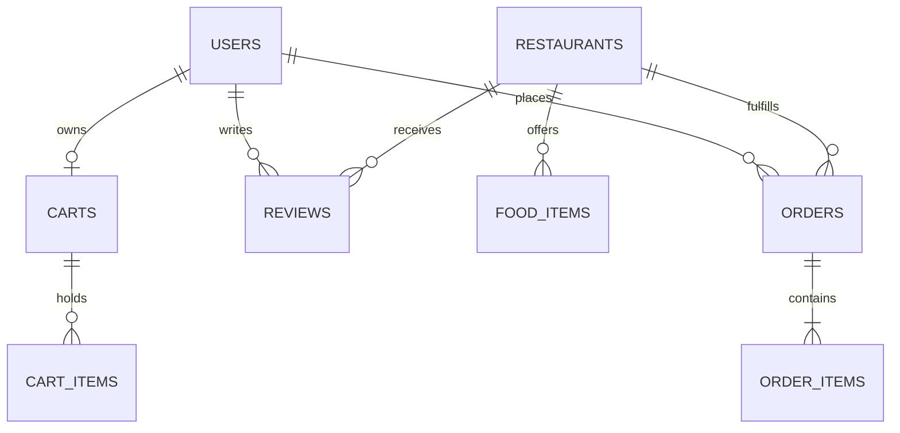

# 🗄️ Database Architecture & MongoDB Atlas Schema Design

**Project:** BiteBuddy (Food Delivery & Restaurant Management System)  
**Target Database:** MongoDB Atlas (Document Store)  
**Document Version:** 1.0.0  
**Status:** Architecture Blueprint for Backend Integration  

---

## 1. Overview & Architectural Principles

Currently, BiteBuddy operates with client-side reactive state managed through `LocalStorage` (`assets/js/core/store.js` and `assets/js/core/data.js`). To support multi-user environments, synchronized kitchen updates, persistent order fulfillment, and role-based security, a future backend (Node.js/Express or NestJS) will integrate with **MongoDB Atlas**.

### Core Backend Rules:
1. **Zero Client Database Credentials:** Browser-side code will never import MongoDB drivers or connect directly to Atlas. All database operations are restricted to server-side controllers.
2. **RESTful Service Layer:** The frontend communicates strictly via the configured API abstraction layer (`assets/js/services/api.service.js`).
3. **Mongoose Document Modeling:** Data schemas are strongly typed with validation, timestamps, and strategic indexing.

---

## 2. Collections & Entity Relationships



---

## 3. Collection Specifications

### 1. `users` Collection
Stores authentication credentials, contact details, role-based authorization levels, and saved delivery addresses.

```javascript
{
  _id: ObjectId("67215a1f1a4e2b001a111111"),
  name: "Rahul Sharma",
  email: "rahul@example.com",             // Unique, indexed
  passwordHash: "$2b$10$wK1Rk7...",       // Bcrypt hashed salt + password
  phone: "+91 98765 43210",               // Indexed for OTP/SMS
  role: "customer",                       // Enum: ["customer", "restaurant", "admin", "rider"]
  restaurantId: null,                     // Set if role === "restaurant"
  avatar: "/assets/images/avatars/user-01.jpg",
  addresses: [
    {
      _id: ObjectId("67215a1f1a4e2b001a111112"),
      title: "Home",
      line1: "Flat 402, Sunshine Heights",
      area: "Andheri West",
      city: "Mumbai",
      state: "Maharashtra",
      pincode: "400058",
      isDefault: true
    }
  ],
  isActive: true,
  createdAt: ISODate("2026-10-29T10:00:00Z"),
  updatedAt: ISODate("2026-10-29T10:00:00Z")
}
```

**Recommended Indexes:**
- `{ email: 1 }` (Unique)
- `{ phone: 1 }`
- `{ role: 1 }`

---

### 2. `restaurants` Collection
Stores partner kitchen profiles, operational hours, minimum order thresholds, and operational statuses.

```javascript
{
  _id: ObjectId("67215b2a1a4e2b001a222222"),
  slug: "spice-route",                    // Unique URL slug
  name: "Spice Route",
  ownerId: ObjectId("67215a1f1a4e2b001a111111"), // Ref: users
  image: "assets/images/restaurants/spice-route.jpg",
  cuisines: ["North Indian", "Mughlai"],
  rating: 4.5,
  reviewsCount: 180,
  deliveryTimeText: "30–40 min",
  deliveryMinutes: 35,
  minOrder: 150,
  costForTwo: 500,
  address: "MG Road, Sector 14, Mumbai",
  pincode: "400050",
  hours: "11:00 AM – 11:30 PM",
  description: "Authentic North Indian and Mughlai flavors crafted in traditional clay tandoors.",
  isFeatured: true,
  isOpen: true,
  createdAt: ISODate("2026-10-20T08:00:00Z"),
  updatedAt: ISODate("2026-10-29T08:00:00Z")
}
```

**Recommended Indexes:**
- `{ slug: 1 }` (Unique)
- `{ cuisines: 1 }`
- `{ rating: -1 }`
- `{ isFeatured: 1 }`

---

### 3. `food_items` Collection
Stores dishes, recipe details, pricing, nutritional information, dietary tags, and kitchen stock status.

```javascript
{
  _id: ObjectId("67215c3b1a4e2b001a333333"),
  restaurantId: ObjectId("67215b2a1a4e2b001a222222"), // Ref: restaurants
  slug: "paneer-tikka",
  name: "Paneer Tikka",
  category: "Starters",                   // Enum: ["Starters", "Main Course", "Breads", "Desserts", "Beverages"]
  price: 249,
  rating: 4.6,
  reviewsCount: 89,
  image: "assets/images/food/paneer-tikka.jpg",
  description: "Fresh cottage cheese marinated in spiced yogurt and grilled in traditional clay oven.",
  isVeg: true,
  isAvailable: true,
  preparationMinutes: 20,
  nutrition: {
    calories: 320,
    proteinGrams: 18,
    carbsGrams: 12,
    fatGrams: 22
  },
  ingredients: ["Paneer", "Yogurt", "Bell Peppers", "Onions", "Garam Masala", "Mustard Oil"],
  createdAt: ISODate("2026-10-22T09:00:00Z"),
  updatedAt: ISODate("2026-10-29T11:00:00Z")
}
```

**Recommended Indexes:**
- `{ restaurantId: 1, category: 1 }`
- `{ isVeg: 1 }`
- `{ price: 1 }`
- `{ name: "text", description: "text" }` (Full-text search)

---

### 4. `carts` Collection (Persistent Cart Storage)
Maintains server-synced cart items for users logged in across multiple devices.

```javascript
{
  _id: ObjectId("67215d4c1a4e2b001a444444"),
  userId: ObjectId("67215a1f1a4e2b001a111111"), // Ref: users (1-to-1)
  items: [
    {
      foodItemId: ObjectId("67215c3b1a4e2b001a333333"),
      name: "Paneer Tikka",
      price: 249,
      quantity: 2,
      subtotal: 498
    }
  ],
  appliedCoupon: {
    code: "WELCOME50",
    discountAmount: 124.50
  },
  updatedAt: ISODate("2026-10-29T12:00:00Z")
}
```

**Recommended Indexes:**
- `{ userId: 1 }` (Unique)
- `{ updatedAt: 1 }` (TTL index for guest cart cleanup if needed)

---

### 5. `orders` Collection
Master transactional record for customer orders, status changes, delivery addresses, and payment receipts.

```javascript
{
  _id: ObjectId("67215e5d1a4e2b001a555555"),
  orderNumber: "FD10245",                 // Human-friendly unique identifier
  userId: ObjectId("67215a1f1a4e2b001a111111"),
  restaurantId: ObjectId("67215b2a1a4e2b001a222222"),
  items: [
    {
      foodItemId: ObjectId("67215c3b1a4e2b001a333333"),
      name: "Paneer Tikka",
      price: 249,
      quantity: 2,
      subtotal: 498
    }
  ],
  pricing: {
    subtotal: 498,
    discount: 50,
    deliveryFee: 40,
    platformFee: 10,
    taxes: 24.90,
    grandTotal: 522.90
  },
  deliveryAddress: {
    fullName: "Rahul Sharma",
    phone: "+91 98765 43210",
    address: "Flat 402, Sunshine Heights, Andheri West",
    city: "Mumbai",
    state: "Maharashtra",
    pincode: "400058"
  },
  payment: {
    method: "UPI",                        // Enum: ["COD", "UPI", "CARD", "NETBANKING"]
    status: "paid",                       // Enum: ["pending", "paid", "failed", "refunded"]
    transactionId: "UPI98234827364"
  },
  status: "preparing",                    // Enum: ["placed", "preparing", "out_for_delivery", "delivered", "cancelled"]
  statusTimeline: [
    { status: "placed", timestamp: ISODate("2026-10-29T12:30:00Z") },
    { status: "preparing", timestamp: ISODate("2026-10-29T12:34:00Z") }
  ],
  estimatedDeliveryTime: ISODate("2026-10-29T13:10:00Z"),
  notes: "Please leave at door.",
  createdAt: ISODate("2026-10-29T12:30:00Z"),
  updatedAt: ISODate("2026-10-29T12:34:00Z")
}
```

**Recommended Indexes:**
- `{ orderNumber: 1 }` (Unique)
- `{ userId: 1, createdAt: -1 }`
- `{ restaurantId: 1, status: 1 }`
- `{ status: 1 }`

---

### 6. `reviews` Collection
Stores customer ratings, text feedback, and moderation flags.

```javascript
{
  _id: ObjectId("67215f6e1a4e2b001a666666"),
  orderId: ObjectId("67215e5d1a4e2b001a555555"),
  userId: ObjectId("67215a1f1a4e2b001a111111"),
  restaurantId: ObjectId("67215b2a1a4e2b001a222222"),
  dishId: ObjectId("67215c3b1a4e2b001a333333"), // Optional, if dish-specific
  rating: 5,                              // Number 1-5
  comment: "Absolutely outstanding Paneer Tikka! Juicy, flavorful, and fast delivery.",
  isApproved: true,                       // Admin moderation toggle
  createdAt: ISODate("2026-10-29T14:00:00Z")
}
```

**Recommended Indexes:**
- `{ restaurantId: 1, createdAt: -1 }`
- `{ dishId: 1 }`
- `{ userId: 1 }`

---

## 4. Migration Roadmap: From LocalStorage to MongoDB Atlas

1. **Phase 1 (Current):** Standalone reactive frontend with `LocalStorage` and `BiteBuddyData` seed catalog.
2. **Phase 2:** Implement Node.js / Express server exposing standard REST endpoints (`/api/food`, `/api/restaurants`, `/api/orders`, `/api/auth`).
3. **Phase 3:** Set `isMockMode: false` in `assets/js/services/api.service.js` to point directly to backend endpoints.
4. **Phase 4:** MongoDB Change Streams / WebSockets for live kitchen order broadcasts to partner dashboards.

